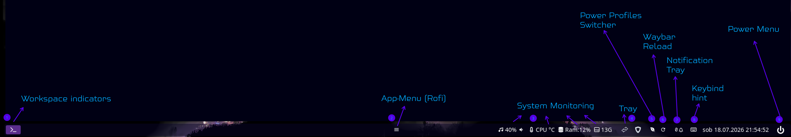

import { Image } from "astro:assets";
import cover from "../../assets/articles/sway/sway.png";

<Image src={cover} alt="" class="cover" loading="eager" width={853} />

Sway setup for EndeavourOS
---

The [`endeavouros-sway-setup`](https://github.com/endeavouros-team/endeavouros-sway-setup) repository contains the official configuration and framework for the **EndeavourOS Sway Edition**.

Rather than offering just a bare-bones window manager configuration, this setup is designed to function as a complete, fully usable desktop environment right out of the box—providing a stable, sensible baseline that users can easily tweak, expand, and personalize.

## System Tools and Customization (`eos-sway-tools`)

The setup integrates scripts from the [`eos-sway-tools`](https://github.com/killajoe/eos-sway-tools) project maintained by `joekamprad (killajoe)`. On an installed system, these scripts and utilities are installed system-wide in `/usr/bin/`.

### Overriding System Scripts

Users can easily customize any of these system-wide tools without modifying `/usr/bin/` directly:

1. Copy the target script from `/usr/bin/<script-name>` to `~/.local/bin/<script-name>`.
2. Modify the file inside `~/.local/bin/`.
3. Because `~/.local/bin/` takes priority in the standard user `$PATH`, your customized version will override the system-wide binary seamlessly.

### Keybinding Helpers

To assist users in navigating Sway shortcuts, the desktop environment provides two complementary helper tools:

* **Dynamic Keyhint Tool (`~/.local/bin/keyhint`):** An interactive GUI helper script that parses and displays active Sway keybindings and descriptions.
* **Simple Keybinding Window:** A static default shortcut overview window that can be opened directly from the right side of the Waybar panel by clicking on the keyboard icon.

## Session Management & Power Menu

The power menu integration handles session termination, screen locking, rebooting, and shutting down. To ensure applications, open files, and system states close safely without data loss, the power menu utilizes `gracefully_exit`. This tool ensures running processes receive clean termination signals before ending the Sway session or powering down the system.

## The Panel (Waybar)

The setup features a customized status bar powered by **Waybar**, situated at the bottom of the screen.

It is organized into distinct functional areas providing real-time system feedback and interactive control points.

### Waybar Modules Overview

* **Workspace Indicators:** Displays active and available Sway workspaces.
* **App-Menu (Rofi):** Quick button to open the Rofi application menu.
* **System Monitoring:** Live indicators for audio volume, CPU temperature/usage, and RAM utilization.
* **System Tray:** Hosts tray icons for background applications and system applets.
* **Power Profiles Switcher:** Direct control to toggle performance, balanced, and power-saver modes.
* **Waybar Reload:** Quick action button to reload Waybar configurations on the fly.
* **Notification Tray:** Interactive launcher for SwayNC (Sway Notification Center).
* **Keybind Hint:** One-click launcher (keyboard icon on the right side) to open the simple default keybinding helper window.
* **Power Menu:** Triggers session termination actions managed via `gracefully_exit`.

## Used Components & Defaults

* **Application Launcher:** Configured with **Rofi** for main menu pop-ups and run menus.
* **Notification Daemon:** Utilizes **SwayNC** (Sway Notification Center) for Wayland-native notifications.
* **Terminal Emulator:** **Foot**, a lightweight and fast Wayland-native terminal.
* **File Manager:** **Thunar** for graphical file browsing.
* **Autotiling:** Integrated automatic tiling helpers to alternate window split orientations.

## Setup configs structure

On an installed EndeavourOS Sway system, configuration files and scripts are deployed to standard target user and system paths:

| Installed Path | Purpose / Description |
| --- | --- |
| `~/.config/sway/config` | Main user Sway configuration entry point |
| `~/.config/sway/config.d/` | Modular user configs (inputs, keybindings, autostart rules) |
| `~/.config/waybar/` | Layout configuration and CSS styles for Waybar |
| `~/.config/swaync/` | Sway Notification Center settings and theme |
| `~/.local/bin/` | User-space scripts (e.g., `keyhint`, custom overrides) |
| `/usr/bin/` | System-wide tools provided by `eos-sway-tools` (including `gracefully_exit`) |

## Resources & Links

* **Repository:** [EndeavourOS Sway Setup on GitHub](https://github.com/endeavouros-team/endeavouros-sway-setup)
* **Tools Repository:** [eos-sway-tools by joekamprad (killajoe) on GitHub](https://github.com/killajoe/eos-sway-tools)

> **General Documentation:
[https://github.com/swaywm/sway/wiki](https://github.com/swaywm/sway/wiki)**
